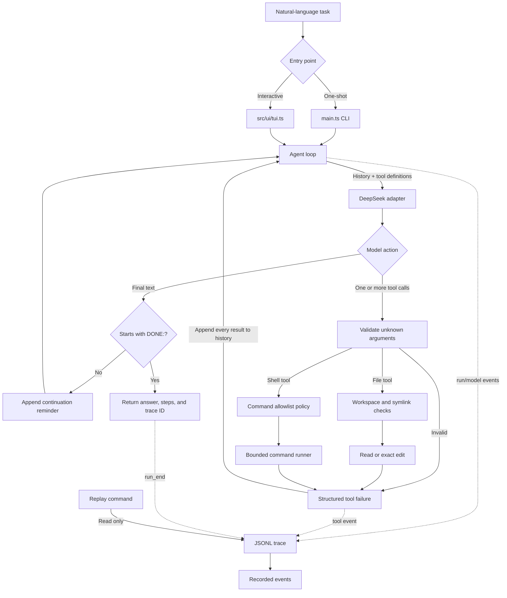

# itemD

itemD is a small, dependency-free TypeScript coding-agent harness that keeps the runtime around the model visible: model calls, tool requests, validation, command execution, workspace boundaries, failures, step limits, and traces.

The model proposes actions. Deterministic harness code validates and executes them.

## What it can do

- Accept a natural-language coding task through a one-shot CLI or persistent terminal interface.
- Call DeepSeek directly with `fetch`, without an SDK or agent framework.
- Read and edit workspace files and run a conservative set of inspection and test commands.
- Validate every model-supplied tool call before execution.
- Execute multiple tool calls from one model turn in deterministic order.
- Return tool failures to the model as observations so it can recover.
- Stop on an explicit `DONE:` response or after 50 model steps.
- Record model calls, tool calls, results, errors, durations, and final status as JSONL.
- Replay a previous run without calling the model or executing tools.

## Requirements

- A recent Node.js release with native erasable TypeScript support and `--env-file`.
- A DeepSeek API key.

There are no runtime dependencies. TypeScript, Node type definitions, and Vitest are development dependencies used for verification.

## Setup

Install the development tooling:

```bash
npm install
```

Create an ignored `.env` file in the project root:

```dotenv
DEEPSEEK_API_KEY=your-api-key
DEEPSEEK_MODEL=deepseek-flash
```

`DEEPSEEK_MODEL` is optional and defaults to `deepseek-flash`.

Type-check every module and run the boundary tests without making a model request:

```bash
npm run check
```

## Terminal interface

Start the interactive interface:

```bash
npm run tui
```

Enter a coding task at the prompt:

```text
itemD> inspect the failing tests and make the smallest focused fix
```

Each submitted task starts an independent agent run with its own history and trace.

| Command | Behavior |
| --- | --- |
| `/help` | Show available commands |
| `/replay <trace-id>` | Display a recorded run without executing it |
| `/clear` | Clear the terminal |
| `/quit` or `/exit` | Exit the interface |

## One-shot CLI

Run one task:

```bash
npm start -- "Read package.json and report the package name. Do not edit files."
```

A successful result includes the answer, model-step count, trace ID, and trace path:

```json
{
  "ok": true,
  "status": "done",
  "answer": "The package name is itemd.",
  "steps": 2,
  "traceId": "7a207062-1f03-427e-a06a-4bdd48a75d5b",
  "tracePath": ".itemd/traces/7a207062-1f03-427e-a06a-4bdd48a75d5b.jsonl"
}
```

Replay the run:

```bash
npm start -- --replay 7a207062-1f03-427e-a06a-4bdd48a75d5b
```

Replay is read-only: it does not contact DeepSeek or execute recorded tools.

## Agent flow



The agent loop owns history, the 50-step limit, and completion. The model adapter only translates between DeepSeek and internal actions. Tool arguments stay `unknown` until validation, and deterministic workspace or command policy runs before execution. Every success and expected failure becomes an observation that the model can use on its next turn.

The original task remains in history for the whole run. DeepSeek tool-call IDs and reasoning content are preserved across turns. Replay follows a separate read-only path and never enters the model or tool-execution flow.

## Model-facing tools

| Tool | Purpose |
| --- | --- |
| `read_file` | Read one UTF-8 workspace file |
| `edit_file` | Replace one exact, unique text occurrence in an existing file |
| `shell` | Run an executable and argument array accepted by the command policy |

External tool input remains `unknown` until it passes handwritten runtime validation. Expected failures use structured results rather than exceptions.

## Safety boundaries

Filesystem operations:

- Resolve paths against the real workspace root.
- Reject paths that resolve outside the workspace.
- Reject symlink escapes.
- Block `.git`, `.itemd`, legacy `.harness`, `.env`, and `.env.*` from
  model-facing tools.
- Limit files and edited output to 200,000 bytes.

Command execution:

- Spawns executables directly without shell interpolation.
- Uses the workspace as the working directory.
- Captures stdout, stderr, exit code, signal, duration, timeout, and truncation state.
- Applies a 30-second timeout and 100,000-character limits to stdout and stderr.
- Treats non-zero exits as tool data rather than harness crashes.

The command policy protects against common accidental host mutation. It is an allowlist, not an operating-system sandbox.

## Supported shell commands

| Executable | Allowed use |
| --- | --- |
| `git` | Read-only `status`, `diff`, `log`, and `show` |
| `ls`, `pwd`, `rg` | Workspace inspection |
| `node` | `--version`, `--check`, and `--test` |
| `npm` | `npm test`, with options only after `--` |
| `python`, `python3` | Version checks, `-m pytest`, and `-m unittest` |

Arbitrary Node or Python evaluation, direct script execution, package installation, Git mutation, sensitive paths, absolute paths, and unsafe command options are denied.

## Tracing and replay

Traces are append-only JSON Lines files under:

```text
.itemd/traces/<trace-id>.jsonl
```

A typical one-tool trace contains:

```text
run_start
model_call
tool_call
model_call
run_end
```

Trace and itemD runtime directories are checked for symlink escapes. Replay accepts only itemD-generated UUIDs and verifies that the target is a regular file inside the trace directory.

Traces are excluded from Git, but they can contain task text, model reasoning, file contents, command output, and errors. Treat them as sensitive local debugging artifacts.

## Repository layout

```text
itemD/
├── main.ts                         # CLI entrypoint and public exports
├── src/
│   ├── agent/
│   │   ├── runner.ts               # Loop, history, completion, step limit
│   │   └── types.ts                # Agent result contracts
│   ├── execution/
│   │   └── command.ts              # Bounded child-process execution
│   ├── model/
│   │   └── adapters/
│   │       └── deepseek.ts         # DeepSeek request/response boundary
│   ├── permissions/
│   │   └── shell-policy.ts         # Deterministic command allowlist
│   ├── shared/
│   │   └── runtime.ts              # Generic guards and error helpers
│   ├── telemetry/
│   │   └── trace.ts                # JSONL tracing and read-only replay
│   ├── tools/
│   │   ├── contracts.ts            # Tool types and runtime validation
│   │   └── dispatcher.ts           # Tool implementations and dispatch
│   ├── ui/
│   │   └── tui.ts                  # Interactive terminal adapter
│   └── workspace/
│       └── files.ts                # Path confinement and file checks
├── tests/
│   └── boundaries.test.ts          # Vitest trust-boundary tests
├── package.json                    # Runtime and verification scripts
├── package-lock.json               # Reproducible tool versions
├── tsconfig.json                   # Strict TypeScript configuration
├── README.md                       # Project documentation
├── current-slice.tmp               # Ignored learning reference
├── .env                            # Ignored DeepSeek configuration
└── .itemd/
    └── traces/                     # Ignored runtime JSONL traces
```

The core remains framework-light: plain functions, explicit types, Node.js built-ins, and no classes.

## Completed learning slices

1. Command execution with structured results.
2. Explicit `read_file`, `edit_file`, and `shell` contracts.
3. Workspace confinement, command policy, timeouts, and output bounds.
4. DeepSeek model boundary and runtime response parsing.
5. Multi-turn agent loop, tool-failure recovery, and explicit completion.
6. JSONL tracing and read-only replay.

The dependency-free terminal interface was added after the six core learning slices.

## Current limitations

- The command allowlist is intentionally narrow.
- Each TUI task starts a new run; there is no persistent cross-task memory.
- Replay displays recorded events but does not filter or summarize them.
- Trace write failures surface as top-level harness failures.
- There is no container isolation, confirmation workflow, browser automation, web UI, or multi-agent system.
