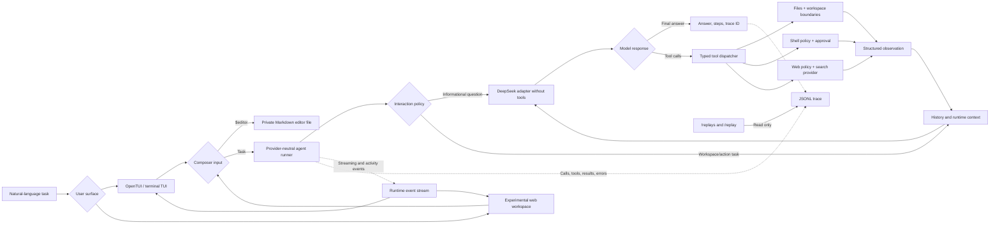

# itemd


itemd is a framework-light TypeScript and Node.js coding-agent harness that
keeps the runtime around the model visible: model calls, tool requests,
validation, command execution, workspace boundaries, failures, step limits, and
traces.

The model proposes actions. Deterministic harness code validates and executes them.

## Setup

Choose one of these installation paths:

- **Standalone release:** no Node.js, Bun, npm, or source checkout is required.
- **Development checkout:** requires Node.js 26.4 or newer and npm.

In both cases, itemd requires a DeepSeek API key.

### Standalone release

Download the asset for your platform from the
[latest GitHub Release](https://github.com/thatShashankGuy/itemd/releases/latest).

Linux x64:

```bash
mkdir -p "$HOME/.local/bin"
curl -fL https://github.com/thatShashankGuy/itemd/releases/latest/download/itemd-linux-x64 \
  -o "$HOME/.local/bin/itemd"
chmod +x "$HOME/.local/bin/itemd"
export PATH="$HOME/.local/bin:$PATH"
itemd --help
itemd
```

Standalone binaries also support `itemd --version`, `itemd --update`, and
`itemd --uninstall`. Update downloads the latest release for the current
platform. Uninstall removes the binary but preserves the saved configuration,
API key, and workspace traces; remove the PATH entry separately if you no
longer want it in your shell.

macOS ARM64 (Apple Silicon):

```bash
mkdir -p "$HOME/.local/bin"
curl -fL https://github.com/thatShashankGuy/itemd/releases/latest/download/itemd-macos-arm64 \
  -o "$HOME/.local/bin/itemd"
chmod +x "$HOME/.local/bin/itemd"
export PATH="$HOME/.local/bin:$PATH"
itemd --help
itemd
```

Add `export PATH="$HOME/.local/bin:$PATH"` to `~/.bashrc`, `~/.zshrc`, or the
startup file for the shell you use to keep the command available in new
terminals. The initial release does not include an Intel macOS binary.

Windows x64 PowerShell:

```powershell
$installDir = Join-Path $env:LOCALAPPDATA "itemd"
New-Item -ItemType Directory -Force $installDir | Out-Null
Invoke-WebRequest `
  -Uri "https://github.com/thatShashankGuy/itemd/releases/latest/download/itemd-windows-x64.exe" `
  -OutFile (Join-Path $installDir "itemd.exe")
$userPath = [Environment]::GetEnvironmentVariable("Path", "User")
[Environment]::SetEnvironmentVariable("Path", "$userPath;$installDir", "User")
$env:Path = "$installDir;$env:Path"
itemd.exe --help
itemd.exe
```

The same `itemd.exe --version`, `itemd.exe --update`, and
`itemd.exe --uninstall` commands are available in PowerShell. Uninstall keeps
the saved configuration and workspace traces.

### Development checkout

Install the development dependencies:

```bash
npm install
```

Create an ignored `.env` file in the project root:

```dotenv
DEEPSEEK_API_KEY=your-api-key
DEEPSEEK_MODEL=deepseek-flash
SERPER_API_KEY=your-serper-api-key
ITEMD_WEB_SEARCH=true
```

`DEEPSEEK_MODEL` is optional and defaults to `deepseek-flash`.
`SERPER_API_KEY` enables the optional web-search provider unless
`ITEMD_WEB_SEARCH=false` is set.

Type-check every module and run the boundary tests without making a model request:

```bash
npm run check
```

### First launch and configuration

When no usable configuration is found, itemd starts a short-lived local setup
page in your browser. It collects the DeepSeek model, reasoning effort, model
API key, and optional Serper API key, then returns you to the OpenTUI session.
The page listens only on `127.0.0.1`, uses a random one-time URL token, and
does not put credentials in the URL or logs. The configuration is stored in
the user-level itemd configuration directory.

You can also set `DEEPSEEK_API_KEY` and `SERPER_API_KEY` in the environment
before starting itemd; environment settings override stored values. Use
`/setup browser` to reopen the local setup page from an active session.

## Usage

Start the installed binary:

```bash
itemd
```

To use the browser interface instead of OpenTUI, run:

```bash
itemd --web
```

This starts a loopback-only web server, opens the full itemd workspace in your
default browser, and keeps the server alive until itemd exits. The web session
uses a random URL token; it is intended for the local machine and should not
be exposed through a proxy or shared network address.

For a development checkout, use `npm start` or `npm run tui`. On first use,
itemd opens the local browser setup page described above. Enter a coding task
in the bottom input:

```text
itemd> inspect the failing tests and make the smallest focused fix
```

Each submitted task starts an independent agent run with its own history and trace.
The transcript supports the mouse wheel, Page Up/Down, and Ctrl+Up/Down. Type
`/` to open the command palette; use Up/Down to select and Tab or Enter to
complete a command. Drag across transcript text to copy it; the footer confirms
the number of characters copied. While an agent task is active, the header
shows an animated loader and Escape stops the task.

General informational questions, such as `What is a closure?`, use a direct
answer mode with no model tools and complete from the first response. Prompts
that mention the workspace or request an action, such as `Fix the failing
tests`, retain the normal tool-enabled agent loop. This classification is
conservative; workspace and action requests remain subject to the existing
tool validation and permission policy. The selected mode is recorded in the
run-start trace event.

Type `$editor` in the terminal composer to open the configured default editor.
`VISUAL` takes precedence over `EDITOR`; editor values may contain quoted
arguments (for example, `code --wait`) and are executed without a shell. If
neither variable is set, itemd uses `vi` on Unix-like systems and `notepad.exe`
on Windows. The editor writes a private temporary Markdown file, and its
contents are loaded back into the composer without being submitted. Empty
messages, editor failures, and cancellation leave the composer usable. The web
interface reports that `$editor` is terminal-only because a browser cannot
open a local editor process.

To run a direct inspection command, prefix it with `!`, for example
`!git status` or `!npm test`. Direct commands use the same workspace boundary,
argument parsing, timeout, output limits, and shell allowlist as model-requested
shell calls; they are never passed through a system shell.

| Command | Behavior |
| --- | --- |
| `/help` | Show available commands |
| `/config` | Show the active provider, model, effort, and web search |
| `/model [model-id]` | Select or change the active model |
| `/effort [none\|low\|high\|max]` | Select or change reasoning effort |
| `/reasoning [on\|off]` | Toggle reasoning in live runs and replay output |
| `/reload` | Reload the API key and model settings from config/environment |
| `/setup` | Open the in-app configuration menu |
| `/setup browser` | Open browser setup for keys and all configuration |
| `/adapter` | Alias for `/setup` |
| `/replays` | List recorded runs |
| `/replay <trace-id>` | Display a recorded run without executing it |
| `/clear` | Clear the terminal |
| `/new` | Start a new session and retain the active configuration |
| `/theme [dark\|light]` | Switch themes; omit the argument to toggle |
| `$editor` | Compose a message in the terminal’s default editor |
| `/quit` or `/exit` | Exit the interface |

From a standalone installation, use `itemd --version` to show the installed
release, `itemd --update` to download the latest platform binary, or
`itemd --uninstall` to remove the binary while preserving configuration.

The full-screen interface starts in dark mode. `/theme light` switches to a
light terminal theme, `/theme dark` switches back, and `/theme` toggles the
current theme. Theme changes affect presentation only; the active provider,
model, credentials, and agent state are unchanged.

The saved configuration lives outside the workspace in the user-level itemd
configuration directory (or at `ITEMD_CONFIG_PATH`) and is written with
user-only permissions where supported. It contains the API key, so treat that
file as a credential. `DEEPSEEK_API_KEY`, `DEEPSEEK_MODEL`,
`DEEPSEEK_REASONING_EFFORT`, `SERPER_API_KEY`, and `ITEMD_WEB_SEARCH` override
saved values; `/reload` applies changes without restarting the TUI. Model and
reasoning changes made with `/model` and `/effort` are saved when a stored
configuration is available. API keys are never rendered in the interface,
traces, or replay output.

## Releases

Release versions are read from `package.json` and use Semantic Versioning,
including prereleases. Each new version creates a
matching `v<version>` Git tag before its GitHub Release is published.

Pushing to `master` starts the GitHub Actions release workflow. It installs
dependencies with npm, runs type-checking and tests, then uses Bun only to
compile the TUI entrypoint into platform-specific standalone binaries:

| Platform | Release asset |
| --- | --- |
| Linux x64 | `itemd-linux-x64` |
| macOS ARM64 | `itemd-macos-arm64` |
| Windows x64 | `itemd-windows-x64.exe` |

To publish a release, update `package.json` to a new version, for example
`0.1.8`, commit the change, and push it to `master`. The workflow
creates the matching `v0.1.8` tag, generates GitHub release notes, and
uploads all three binaries. If that tag already exists, no duplicate release
is created. The binaries start the interactive OpenTUI interface; run
`itemd --help` for the harmless smoke-test command.

## Recent feature map

The recent runtime and UI work is organized around explicit boundaries rather
than a framework layer:

| Area | What it adds | Primary implementation |
| --- | --- | --- |
| OpenTUI runtime | Streaming model/tool activity, shell approval panels, session navigation, and responsive context panels | `src/ui/opentui.ts`, `src/ui/opentui-activity.ts`, `src/agent/events.ts` |
| Sessions and replay | Resumable sessions, persisted message history, `/sessions`, `/resume`, `/replays`, and read-only replay | `src/session/`, `src/telemetry/trace.ts`, `src/session/presentation.ts` |
| Web workspace | Experimental browser workspace with multiline input, slash-command completion, theme/configuration controls, session pickers, and replay | `src/ui/web.ts`, `src/config/browser-setup.ts` |
| Direct answers | Informational questions can use a tool-free interaction mode; workspace-dependent questions retain the agent loop | `src/agent/interaction-policy.ts`, `src/agent/runner.ts`, `src/model/adapters/deepseek.ts` |
| Editor composer | `$editor` opens `VISUAL` or `EDITOR`, loads saved Markdown into the terminal composer, and never submits automatically | `src/ui/editor.ts`, `src/ui/opentui.ts` |
| Provider setup | Validated DeepSeek model/effort selection, masked setup input, environment overrides, and user-level configuration | `src/model/catalog.ts`, `src/config/configuration.ts`, `src/ui/setup.ts` |
| Release hardening | Platform-specific `node-pty` assets, version-bump verification, and protected release workflows | `.github/workflows/release.yml`, `.github/workflows/protect-release-workflow.yml` |

## Agent flow



The agent runner owns history, the configured hard step limit, completion, and
cancellation. The interaction policy selects the tool-free path only when the
answer is available from the prompt and known context; action-oriented or
workspace-dependent requests use the normal dispatcher. The model adapter only
translates between DeepSeek and internal actions.

Tool arguments stay `unknown` until validation, and deterministic workspace,
shell, approval, and web policies run before execution. Every success and
expected failure becomes an observation that the model can use on its next turn.

The original task remains in history for the whole run. DeepSeek tool-call IDs
and reasoning content are preserved across turns. Session persistence stores
canonical messages separately from telemetry, while replay follows a separate
read-only path and never enters the model or tool-execution flow.

## Model-facing tools

| Tool | Purpose |
| --- | --- |
| `read_file` | Read one UTF-8 workspace file |
| `write_file` | Create a file or replace an existing regular file with complete UTF-8 content |
| `edit_file` | Replace one exact, unique text occurrence in an existing file |
| `delete_file` | Delete one existing regular workspace file |
| `list_files` | List immediate files and directories in a workspace directory |
| `search_files` | Search workspace text files for a literal string with paths and line numbers |
| `shell` | Run an executable and argument array accepted by the command policy |
| `web_search` | Search the public web and return up to five normalized results |
| `web_fetch` | Fetch bounded text from one public URL returned by search |

External tool input remains `unknown` until it passes handwritten runtime validation. Expected failures use structured results rather than exceptions.

## Safety boundaries

Filesystem operations:

- Resolve paths against the real workspace root.
- Reject paths that resolve outside the workspace.
- Reject symlink escapes.
- Block `.git`, `.itemd`, legacy `.harness`, `.env`, and `.env.*` from
  model-facing tools.
- Limit files and edited output to 200,000 bytes.

Command execution:

- Spawns executables directly without shell interpolation.
- Uses the workspace as the working directory.
- Captures stdout, stderr, exit code, signal, duration, timeout, and truncation state.
- Applies a 30-second timeout and 100,000-character limits to stdout and stderr.
- Treats non-zero exits as tool data rather than harness crashes.

The command policy protects against common accidental host mutation. It is an allowlist, not an operating-system sandbox.

## Supported shell commands

| Executable | Allowed use |
| --- | --- |
| `git` | Read-only `status`, `diff`, `log`, and `show` |
| `ls`, `pwd`, `rg` | Workspace inspection |
| `node` | `--version`, `--check`, and `--test` |
| `npm` | `npm test`, with options only after `--` |
| `python`, `python3` | Version checks, `-m pytest`, and `-m unittest` |

Arbitrary Node or Python evaluation, direct script execution, package installation, Git mutation, sensitive paths, absolute paths, and unsafe command options are denied.

Web access:

- Is disabled unless web search is enabled and a Serper API key is configured.
- Uses Serper search and scrape endpoints through a provider boundary; the key
  is never returned in tool output, errors, traces, or replay output.
- Returns at most five search results with only title, URL, and snippet fields.
- Bounds fetched page text to 20,000 normalized characters.
- Allows only public `http` and `https` URLs without embedded credentials.

## Tracing and replay

Traces are append-only JSON Lines files under:

```text
.itemd/traces/<trace-id>.jsonl
```

A typical one-tool trace contains:

```text
run_start
model_call
tool_call
model_call
run_end
```

Trace and itemd runtime directories are checked for symlink escapes. Replay
accepts only itemd-generated UUIDs and verifies that the target is a regular
file inside the trace directory.

Traces are excluded from Git, but they can contain task text, model reasoning, file contents, command output, and errors. Treat them as sensitive local debugging artifacts.

## Repository layout

```text
itemd/
├── main.ts                         # OpenTUI CLI entrypoint and public exports
├── src/
│   ├── agent/
│   │   ├── events.ts               # Runtime event contracts
│   │   ├── interaction-policy.ts   # Direct-answer vs tool-assisted mode
│   │   ├── runner.ts               # Loop, history, completion, cancellation
│   │   └── types.ts                # Agent result contracts
│   ├── config/
│   │   ├── browser-setup.ts        # Local browser configuration page
│   │   └── configuration.ts        # Validated user-level configuration
│   ├── execution/
│   │   ├── command.ts              # Bounded child-process execution
│   │   └── shell-input.ts          # Safe executable/argument parsing
│   ├── model/
│   │   ├── adapters/deepseek.ts    # DeepSeek request/response boundary
│   │   ├── catalog.ts              # Enabled/disabled provider metadata
│   │   ├── factory.ts              # Provider-neutral adapter factory
│   │   ├── history.ts              # Model message history helpers
│   │   └── types.ts                # Model and action contracts
│   ├── permissions/
│   │   ├── shell-approval.ts       # Interactive approval controller
│   │   ├── shell-policy.ts         # Deterministic command allowlist
│   │   └── web-policy.ts           # Network/search policy
│   ├── session/
│   │   ├── presentation.ts         # Session message presentation
│   │   ├── service.ts              # Session lifecycle and resume logic
│   │   └── store.ts                # Persisted session storage
│   ├── shared/
│   │   └── runtime.ts              # Generic guards and error helpers
│   ├── telemetry/
│   │   └── trace.ts                # JSONL tracing and read-only replay
│   ├── tools/
│   │   ├── contracts.ts            # Tool types and runtime validation
│   │   └── dispatcher.ts           # Tool implementations and dispatch
│   ├── ui/
│   │   ├── commands.ts             # Slash command catalog and discovery
│   │   ├── editor.ts                # Safe $editor composer flow
│   │   ├── feedback.ts             # Loader and selection-copy feedback
│   │   ├── opentui-activity.ts      # Activity and approval presentation
│   │   ├── opentui.ts               # Full-screen OpenTUI renderer
│   │   ├── setup.ts                 # Masked, injectable provider setup
│   │   ├── tui.ts                   # TUI implementation and line interface
│   │   └── web.ts                   # Loopback browser workspace
│   ├── web/
│   │   └── provider.ts              # Optional web-search provider
│   └── workspace/
│       └── files.ts                # Path confinement and file checks
├── tests/
│   ├── agent-*.test.ts              # Runner, events, streaming, cancellation
│   ├── session-*.test.ts            # Persistence and resume behavior
│   ├── *ui*.test.ts                 # TUI, OpenTUI, web, and setup behavior
│   └── boundaries.test.ts           # Workspace, trace, and tool boundaries
├── .github/workflows/
│   ├── release.yml                  # Verify, build, tag, and publish releases
│   └── protect-release-workflow.yml # Prevent release workflow deletion
├── package.json                    # Runtime and verification scripts
├── package-lock.json               # Reproducible tool versions
├── tsconfig.json                   # Strict TypeScript configuration
├── README.md                       # Project documentation
├── feature-tracker.md              # Unfinished work and future pipeline
├── .env                            # Ignored DeepSeek configuration
└── .itemd/
    └── traces/                     # Ignored runtime JSONL traces
```

The core remains framework-light: plain functions, explicit types, Node.js
built-ins, and only small focused classes where lifecycle behavior benefits from
one.

## Current limitations

- The command allowlist is intentionally narrow.
- New tasks start independent runs; explicit session persistence and resume are
  available when the user selects a session.
- Replay displays recorded events but does not filter or summarize them.
- Trace write failures surface as top-level harness failures.
- Shell approvals are interactive and currently terminal-oriented.
- There is no container isolation, MCP integration, browser automation, or multi-agent system.
